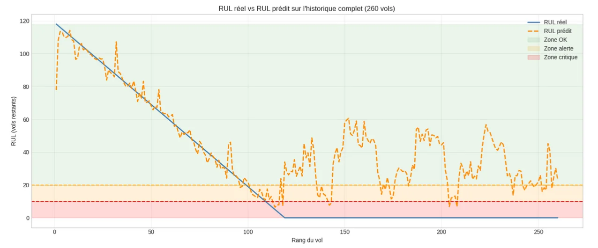
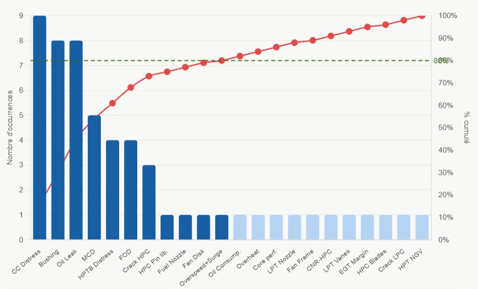
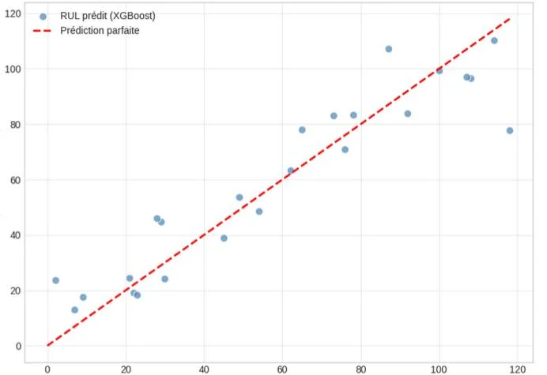
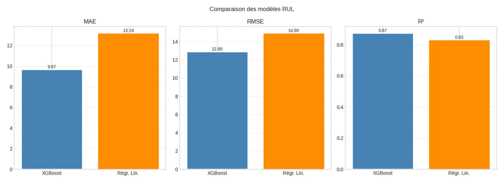
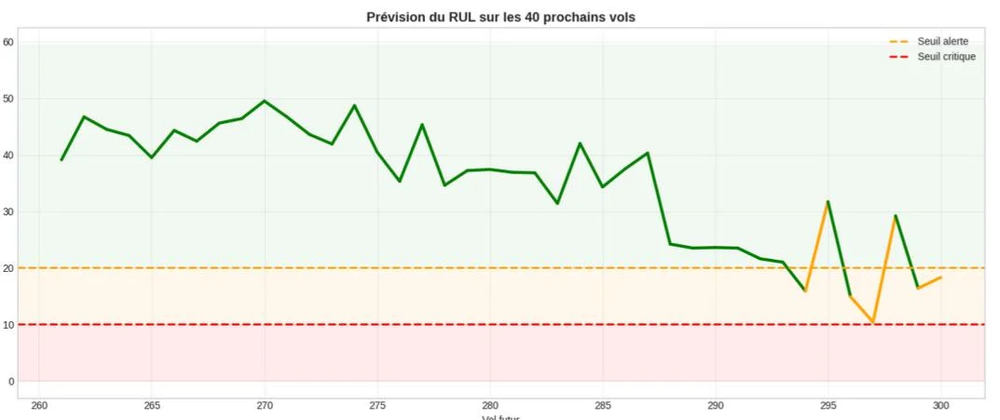

<div align="center">

# Maintenance prédictive d’un turboréacteur CFM56-7B

**Analyse des défaillances · AMDEC · Fiabilité · Prédiction de la durée de vie résiduelle (RUL)**

[](https://elmokhtarrayadi.github.io/maintenance-predictive-turboreacteur/)
[](https://github.com/elmokhtarrayadi)

Pareto · AMDEC · Excel · Python · XGBoost



</div>

## Le problème

Une dépose non programmée de turboréacteur immobilise l’avion et coûte cher en réparation. L’objectif de ce projet était de **passer d’une maintenance subie à une maintenance anticipée** : identifier les défaillances qui pèsent le plus sur une flotte de CFM56-7B, puis **prédire le nombre de vols restants avant la panne** à partir des paramètres surveillés en vol.

## Résultats clés

| Indicateur | Résultat |
| :-- | --: |
| Moteurs analysés | **29** (22 déposes non programmées) |
| Causes représentant ≈ 80 % des défaillances | **7**, dont 6 dans le module MM02 (cœur moteur) |
| Précision du modèle XGBoost | **R² = 0,87** · MAE = 9,7 vols · RMSE = 12,9 vols |
| Gain par rapport à une régression linéaire | **−27 %** d’erreur moyenne |
| Anticipation de la panne | **9 à 19 vols** avant la défaillance réelle |

## Démarche


### 1. Structuration des données
Les rapports d’atelier et les historiques de dépose ont été regroupés dans une base Excel : TSN/CSN, TSI/CSI, dates et motifs de dépose. Les déposes programmées (limite de vie des pièces, convenance) ont été exclues pour ne garder que les **défaillances subies**.

### 2. Pareto des causes de dépose
Sur 22 types de causes, **7 représentent environ 80 % des défaillances** : chambre de combustion, usure des bagues, fuite d’huile, problème MCD, aubes de turbine HP, ingestion de corps étrangers (FOD) et fissures du compresseur HP. Six d’entre elles touchent le **module MM02 (cœur moteur)**.

<p align="center"></p>

### 3. AMDEC et priorité technico-économique
Grilles de cotation sur 6 niveaux pour la **gravité**, l’**occurrence** et la **détectabilité**, définies avec les équipes méthodes et maintenance. La criticité **C = G × O × D** est ensuite pondérée par le coût total de chaque défaillance (réparation et immobilisation).
Les défaillances les plus critiques sont la **détérioration des aubes de turbine HP**, le **FOD**, la **chambre de combustion** et les **fissures du compresseur HP**. Toutes appartiennent au module MM02, qui devient la cible de la surveillance prédictive.

### 4. Modèle de maintenance prédictive
- **Indicateurs retenus** : marge EGT (dégradation thermique), vibrations N2 du cœur moteur (déséquilibre, usure) et CSN (vieillissement).
- **Construction du RUL** : la panne de référence est le premier vol où un seuil critique est dépassé (marge EGT < 10 °C ou vibrations > 0,095). Ici, c’est le vol 119, d’où un RUL maximal de 118 vols.
- **Modèle** : XGBoost (200 arbres) sur 260 vols, découpage 80 % entraînement / 20 % test, comparé à une régression linéaire.

| Modèle | MAE | RMSE | R² |
| :-- | --: | --: | --: |
| **XGBoost** | **9,67 vols** | **12,89 vols** | **0,872** |
| Régression linéaire | 13,19 vols | 14,90 vols | 0,829 |

<p align="center">


</p>

### 5. Aide à la décision
Le modèle classe chaque vol en **Normal** (RUL > 20), **Planifier la maintenance** (RUL < 20) ou **Intervenir** (RUL < 10). Sur l’historique, il entre en zone d’alerte vers le vol 100 et en zone critique vers le vol 110, soit **9 à 19 vols avant la panne**. Une simulation des 40 vols suivants recommande de planifier une visite atelier dès le vol 294, sans atteindre la zone critique.

<p align="center"></p>

## Démo interactive

La [**démonstration en ligne**](https://elmokhtarrayadi.github.io/maintenance-predictive-turboreacteur/) permet de :
- calculer une **criticité AMDEC** avec les grilles de cotation de l’étude ;
- faire varier la **marge EGT** et les **vibrations** pour voir la décision de maintenance ;
- comparer les **performances des modèles** et parcourir les graphiques d’analyse.

## Compétences mobilisées

Analyse des défaillances · Pareto · AMDEC · Indicateurs de fiabilité (λ, MTBF, MTTR, disponibilité) · Structuration de données sous Excel · Python · Machine learning (XGBoost) · Aide à la décision de maintenance

## Perspectives

- Entraîner le modèle sur plusieurs moteurs et plusieurs pannes pour qu’il généralise ;
- Ajouter d’autres paramètres de surveillance (analyse d’huile, débit carburant, N1/N2) ;
- Intégrer les prédictions dans un tableau de bord de planification des visites atelier.

> Données d’exploitation d’une compagnie aérienne, anonymisées : seuls la méthode et les résultats agrégés sont présentés.

## Structure du dépôt

```text
├── index.html   # démo interactive
├── style.css    # mise en page
├── app.js       # calcul AMDEC, seuils de surveillance, galerie
└── assets/      # graphiques d’analyse et de résultats
```

---

<div align="center">

**Elmokhtar Rayadi** · Élève ingénieur en Génie Mécanique des Systèmes Industriels · [Tous mes projets](https://github.com/elmokhtarrayadi)

</div>
